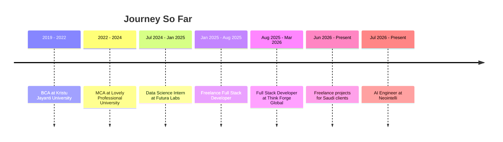

<div align="center">


<a href="https://github.com/markasif">
  
</a>

<br/>


<br/><br/>

<a href="https://my-portfolio-4x77.vercel.app/#projects"></a>
<a href="https://www.linkedin.com/in/asifap/"></a>
<a href="mailto:apasif243@gmail.com"></a>
<a href="https://neointelli.com/"></a>

</div>

<br/>

## ⚡ About Me

<table>
<tr>
<td width="62%" valign="top">

I'm an **AI Engineer and Full Stack Developer (MERN)** with **2+ years of experience** building production web platforms and LLM-powered systems.

- 🤖 Currently an **AI Engineer at [Neointelli](https://neointelli.com/)** (Bengaluru), designing **RAG pipelines, multi-agent architectures and MCP servers**
- 🧑‍💼 Building **NeoHireX**, an end-to-end AI recruitment platform that handles a company's full hiring workflow
- 🎨 Leading the **redesign of the Neointelli website**
- 🌍 Delivered **live payment and VAT-enabled commerce and billing platforms** for Saudi clients
- 🚀 Shipped **10+ production B2B / SaaS systems** across industries
- ⚡ Cut delivery time by **~30%** by standardising AI-assisted workflows

</td>
<td width="38%" valign="top">

```yaml
name: Mohammed Asif
role: AI Engineer
focus:
  - RAG Systems
  - Multi-Agent Architectures
  - MCP Servers & Integrations
  - Full Stack (MERN)
experience: 2+ years
location: India
status: Building @ Neointelli
```

</td>
</tr>
</table>

---

## 🧠 What I Do

<div align="center">

<table>
<tr>
<td align="center" width="25%">🤖<br/><b>AI Agents & MCP</b><br/><sub>Multi-agent workflows, custom MCP servers, tool integrations</sub></td>
<td align="center" width="25%">📚<br/><b>RAG Systems</b><br/><sub>Vector search, conversational memory, semantic retrieval</sub></td>
<td align="center" width="25%">⚡<br/><b>Real-Time Systems</b><br/><sub>WebSocket dashboards, RBAC, live data feeds</sub></td>
<td align="center" width="25%">💳<br/><b>Payments & Billing</b><br/><sub>Gateway integration, VAT-compliant invoicing</sub></td>
</tr>
<tr>
<td align="center">🧩<br/><b>Admin Platforms</b><br/><sub>CMS-driven apps with full content control</sub></td>
<td align="center">📈<br/><b>Performance & SEO</b><br/><sub>Core Web Vitals, structured data, 90+ PageSpeed</sub></td>
<td align="center">🛠️<br/><b>End-to-End Delivery</b><br/><sub>UI to API to database to deployment</sub></td>
<td align="center">🧪<br/><b>Quality</b><br/><sub>Jest tests, Zod validation, CI/CD pipelines</sub></td>
</tr>
</table>

</div>

---

## 🛠️ Tech Stack

<div align="center">

**🤖 AI / LLM**


<br/><br/>

**🌐 Frontend**


**⚙️ Backend**


**🗄️ Databases & Cloud**


**🧰 Tools**


</div>

---

## 🚀 Featured Work

### 🏢 At Neointelli

| Project | What it is | Focus |
|---|---|---|
| 🧑‍💼 **NeoHireX** | End-to-end AI recruitment platform that handles the full hiring workflow for companies | RAG • Agents • MCP |
| 🎨 **[Neointelli Website](https://neointelli.com/)** | Full redesign of the company website | Modern component-based front end |

### 🌍 Freelance (Live, Saudi Clients)

| Project | What it is | Highlights |
|---|---|---|
| ☕ **[Goodwell Coffee](http://goodwellcoffee.com/)** | Full e-commerce store: frontend, backend, database | Online payments • VAT calculation |
| 🧾 **[Broastfly Billing](https://broastfly.com/billing/)** | Billing system used for daily operations | Payment integration • VAT-compliant invoicing |

### 💼 Production Platforms

| Project | What it is | Highlights |
|---|---|---|
| 💹 **[Forex Trading CRM](https://zyvest.com/)** | Real-time B2B trading system with dashboards and role-based workflows | Mobile LCP **4.1s → 3.1s** • Zero role-access bugs • 0% → 60% test coverage |
| 📊 **[Depro Trading](https://www.deprotrading.com/)** | Admin-driven platform with analytics and SEO | Supabase RLS • **90+ mobile PageSpeed** • Cloudinary CDN |
| 🥋 **[WFSK Karate Federation](https://wfsk-world-federation-of-shotokan-k.vercel.app/)** | CMS-driven global federation website | **70%+ content admin-managed** • ~40% faster feature builds |

### 🤖 AI Projects

| Project | What it is | Highlights |
|---|---|---|
| 💬 **[RAG Chatbot with Memory](https://github.com/markasif/Rag-Q-N-With-History)** | Conversational RAG over your documents | Sub-300ms retrieval • 20+ turn context • LangChain + FAISS + FastAPI |
| 📰 **[AI News Aggregator](https://github.com/markasif/News_Generator)** | Semantic news search engine | 4× faster than keyword search • LangChain + FAISS |

---

## 🗺️ Career Timeline



---

## 📊 GitHub Stats

<div align="center">


<br/>


<br/>


</div>

---

## 🤝 Let's Connect

<div align="center">

I'm always open to talking about AI agents, RAG, MCP and full stack products.

<a href="https://www.linkedin.com/in/asifap/"></a>  
<a href="mailto:apasif243@gmail.com"></a>  
<a href="https://github.com/markasif"></a>  
<a href="https://my-portfolio-4x77.vercel.app/#projects"></a>

<br/><br/>


</div>
