 

  

  

  

  

 

<table>
<tr>
<td width="50%"></td>
<td width="50%"></td>
</tr>
<tr>
<td width="50%"></td>
<td width="50%"></td>
</tr>
<tr>
<td width="50%"></td>
<td width="50%"></td>
</tr>
<tr>
<td width="50%"></td>
<td width="50%"></td>
</tr>
</table>

 

  

 

 

 

  

&nbsp;&nbsp;
&nbsp;&nbsp;
&nbsp;&nbsp;

 

