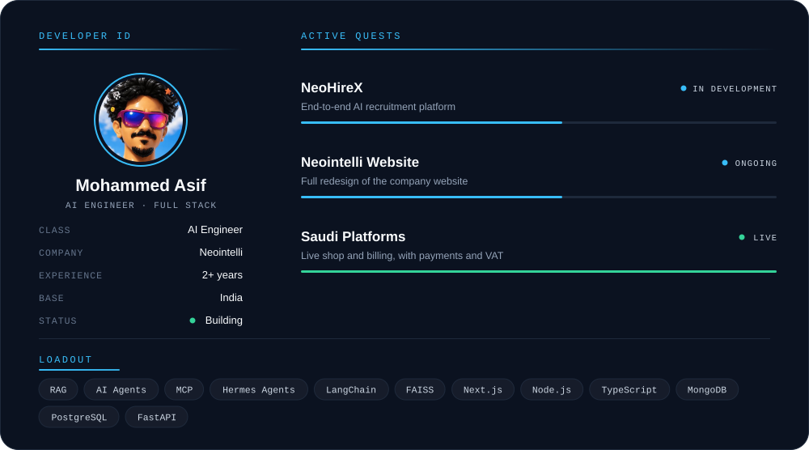

  

 

  

 

## 🧠 What I Do

<table>
<tr>
<td align="center" width="25%">🤖 <b>AI Agents & MCP</b> Multi-agent workflows, custom MCP servers, tool integrations</td>
<td align="center" width="25%">📚 <b>RAG Systems</b> Vector search, conversational memory, semantic retrieval</td>
<td align="center" width="25%">⚡ <b>Real-Time Systems</b> WebSocket dashboards, RBAC, live data feeds</td>
<td align="center" width="25%">💳 <b>Payments & Billing</b> Gateway integration, VAT-compliant invoicing</td>
</tr>
<tr>
<td align="center">🧩 <b>Admin Platforms</b> CMS-driven apps with full content control</td>
<td align="center">📈 <b>Performance & SEO</b> Core Web Vitals, structured data, 90+ PageSpeed</td>
<td align="center">🛠️ <b>End-to-End Delivery</b> UI to API to database to deployment</td>
<td align="center">🧪 <b>Quality</b> Jest tests, Zod validation, CI/CD pipelines</td>
</tr>
</table>

---

## 🛠️ Tech Stack

**🤖 AI / LLM**

  

**🌐 Frontend**

**⚙️ Backend**

**🗄️ Databases & Cloud**

**🧰 Tools**

---

## 🚀 Featured Work

**🏢 At Neointelli**

<table>
<tr>
<td width="50%"></td>
<td width="50%"></td>
</tr>
</table>

**🌍 Freelance · Live Saudi Platforms**

<table>
<tr>
<td width="50%"></td>
<td width="50%"></td>
</tr>
</table>

**💼 Production Platforms**

<table>
<tr>
<td width="50%"></td>
<td width="50%"></td>
</tr>
<tr>
<td width="50%"></td>
<td width="50%"></td>
</tr>
</table>

---

  

---

## 📊 GitHub Stats

 

 

---

&nbsp;&nbsp;
&nbsp;&nbsp;
&nbsp;&nbsp;

 

